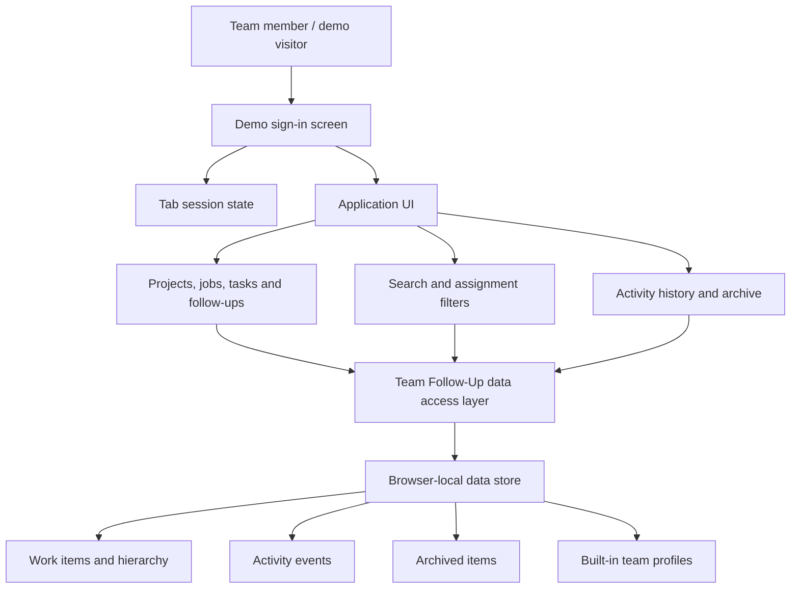

# Team Follow-Up Application

A bilingual (English/Arabic) team workspace for organizing projects, jobs, tasks, follow-ups, assignments, priorities, and activity history.

**Demo URL: [retzed.github.io/Team_Follow-Up](https://retzed.github.io/Team_Follow-Up/)** · [Project guide](PROJECT_GUIDE.md) · [Application architecture](docs/ARCHITECTURE.md) · [Complete application documentation](docs/DOCUMENTATION.md)

> **Demo only:** this public build uses browser-local demo sign-in and local browser storage. It has no server-side database or real authentication. Do not enter private, personal, or confidential information. Each browser profile has its own copy of the demo data.

## Try the demo

1. Open the [hosted demo application](https://retzed.github.io/Team_Follow-Up/). If the site has not been published for this repository yet, follow the one-time [GitHub Pages setup](PROJECT_GUIDE.md#7-github-pages-publishing).
2. Enter one of the built-in team usernames below. English and Arabic aliases are supported.
3. Enter **any non-empty password** and sign in. The password is not checked; this is intentionally only a demonstration flow.
4. Explore sample projects, jobs, tasks, follow-ups, assignments, activity history, search filters, and archive.

| Demo teammate | Username (English) | Username (Arabic) | Team label |
|---|---|---|---|
| Marwa | `Marwa` | `مروة` | Team Leader |
| Zyad | `Zyad` | `زياد` | AWS Engineer |
| Nadine | `Nadine` | `نادين` | AWS Engineer |
| Omar | `Omar` | `عمر` | AWS Engineer |
| Haneen | `Haneen` | `حنين` | AWS Engineer |
| Dina | `Dina` | `دينا` | AWS Engineer |

The demo username selects which teammate appears as the current user; the password does not protect an account. Demo sign-in is not suitable for real users or real data.

### Where does demo data go?

- Work items, assignments, archive entries, and activity events are saved in the browser's `localStorage` for this site.
- The demo sign-in session is stored in the current browser tab's `sessionStorage`.
- Visitors using another browser, device, profile, or private window have a separate local workspace. The app does not synchronize demo data over the internet.

## What the application does

- Organizes work into **Projects** and **Jobs** at the top level.
- Supports **Tasks** and **Follow-ups** beneath eligible parent items.
- Tracks assignees, status, priority, due dates, descriptions, and changes.
- Provides item-specific and application-wide activity history.
- Includes archive, hierarchy-aware restore, search, assignment filters, and overview counts.
- Supports English and Arabic interface languages, including mixed-language item names.
- Includes responsive desktop/mobile layouts and light/dark themes.

## Application architecture

The hosted demo is a static client-side application. Its data layer is an in-browser adapter that provides a consistent asynchronous interface over local browser storage.



This repository deliberately focuses on the application rather than cloud-specific deployment infrastructure. No separate server process is required for the current demo. See [docs/ARCHITECTURE.md](docs/ARCHITECTURE.md) for the component/data flow and the boundary intended for a future interchangeable backend.

## System requirements

**For using the demo:** a current desktop or mobile browser with JavaScript enabled and browser storage available. No GPU, database server, cloud account, or special hardware is required. The demo is tested as a static browser application; persistent demo data requires the browser to allow site storage.

**For development:** Git to clone the repository, Node.js 20 or newer for the test/build scripts, and Python 3 if you want to use Python's built-in local HTTP server. A typical modern laptop or desktop is sufficient; 2 CPU cores, 4 GB RAM, and roughly 500 MB of free disk space are practical recommendations, not strict application limits. No third-party npm packages are currently required.

## Installation

Clone the repository and change into its root directory:

```bash
git clone https://github.com/retzed/Team_Follow-Up.git
cd Team_Follow-Up
```

No dependency installation is needed for the current demo. The application uses browser-native APIs, and the test/build scripts do not require third-party npm packages. Install Node.js 20 or newer only if you plan to run the validation/build commands.

## Run locally

You only need a modern browser to open `index.html`. For a more representative local setup, serve the project over HTTP:

**Python**

```bash
python -m http.server 8000
```

Then open [http://localhost:8000](http://localhost:8000).

**Node.js development checks** (Node.js 20 or newer recommended)

```bash
npm test
npm run build
```

The static build is written to `dist/index.html`. No third-party package install is currently required for the application tests or build.

## Configuration

The browser-local demo is intentionally zero-configuration. It does not need a .env file, AWS account, Cognito configuration, API URL, backend server, or database setup. scripts/build.mjs replaces the runtime-configuration block with demo-only settings and explicitly clears AWS user-pool, client, and API values. Do not add production credentials or private data to the public repository.

To rebuild the static artifact after changing the source:

```bash
npm run build
```

The generated dist/index.html is the browser-loadable deployment artifact. Preview that artifact locally with:

```bash
python -m http.server 8000 --directory dist
```

Then open [http://localhost:8000](http://localhost:8000).

## API documentation

The public demo has **no HTTP/REST API** and makes no requests to a remote database. TeamFollowUpDataApi is an internal asynchronous JavaScript interface implemented in the browser; its built-in adapter persists the demonstration workspace in localStorage. Its method names are not externally callable HTTP endpoints.

For the separate Cognito/API Gateway/Lambda/DynamoDB implementation, see the [AWS deployment repository](https://github.com/retzed/Team_Follow-Up_AWS-Deployment), which documents that API contract.

## Executable artifact and deployed application

This is a browser-based web application, so a native .exe, .jar, or .apk package is not applicable. The deployable web artifact is dist/index.html plus .nojekyll; the GitHub Actions workflow builds it and publishes it to GitHub Pages.

- **Run the deployed demo:** [https://retzed.github.io/Team_Follow-Up/](https://retzed.github.io/Team_Follow-Up/)
- **Review deployment status/build:** [GitHub Actions — Test and deploy demo](https://github.com/retzed/Team_Follow-Up/actions/workflows/pages.yml)

The deployed URL runs the browser-local demo, not the AWS-backed shared-data application. Demo sign-in is not secure authentication, and data is not synchronized between different browsers/devices.

## Project structure

```text
.
├── index.html                 # Complete responsive UI and built-in demo adapter
├── package.json               # Local build and regression-test commands
├── PROJECT_GUIDE.md           # Step-by-step user and developer guide
├── RELEASE_NOTES.md           # Application-focused release notes
├── docs/
│   ├── ARCHITECTURE.md        # UI, data model, and browser storage architecture
│   └── DOCUMENTATION.md       # Full product, developer, security, and testing reference
├── scripts/
│   ├── build.mjs              # Create the static demo artifact
│   ├── check-syntax.mjs       # Parse inline JavaScript
│   └── test-*.mjs             # Regression tests for data/UI behavior
└── .github/
    └── workflows/
        └── pages.yml          # Test and publish the demo with GitHub Pages
```

## Development and contributions

- Read [PROJECT_GUIDE.md](PROJECT_GUIDE.md) before making changes.
- Keep the current demo functional without a server, external database, or cloud account.
- Add a regression test for behavior changes where practical. Run `npm test` before pushing.
- Work on feature branches and use pull requests to review larger changes.
- Keep secrets, personal information, credentials, generated output, and local environment files out of source control.

Changes pushed to `main` run the test suite and publish the demo through GitHub Pages. The deployment workflow is in [`.github/workflows/pages.yml`](.github/workflows/pages.yml).

## Current scope and future work

**Included now:** the browser application, local demo sign-in, sample data, client-side persistence, UI/data regression tests, project documentation, and automated static-site publishing.

**Not included in the public demo:** shared multi-user persistence, real account authentication, a server-side API, or a production database. A future backend can be introduced behind the data access interface without tying the product to any particular cloud provider.
