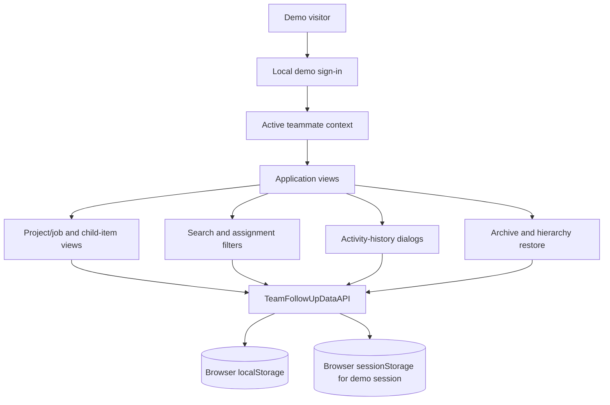

# Application Architecture

## Scope

The public project is a static, browser-only demo. The user interface, client-side application logic, data-access interface, and local storage adapter are currently contained in `index.html`. There is no network database or server process in the public demo.

## Component diagram

## Layers

### Presentation

The UI contains the layout, popups, forms, responsive/mobile controls, English and Arabic labels, RTL/LTR support, theme handling, search filters, item cards, and activity-history views.

### Application state and rules

The app manages the selected project/job, nested children, status/priority/assignee fields, create/edit/delete commands, filters, archive selections, and the activity stream. Project/job items remain top-level. A task belongs to a project; a follow-up belongs to a project, job, or task. A job cannot contain tasks.

### Data-access boundary

The frontend uses an asynchronous data-access interface (exposed as `TeamFollowUpDataAPI`) so UI code can request bootstrap data, users, items, children, assignments, history, archive entries, and restore operations without treating browser storage as the view model itself.

### Local data adapter

The demo implementation saves its workspace in `localStorage` and remembers the active demo user in `sessionStorage`. It stores logical collections for work items, activity events, built-in user profiles, and archived items. Index-like keys and sorted fields support the list/search patterns required by the UI.

This storage is per browser profile and origin. It offers no isolation between demo usernames within one browser, no remote synchronization, and no production-grade authorization.

## Data-flow example: status update

1. The visitor selects a child item and changes its status.
2. The UI validates the change and creates the corresponding activity-event record.
3. The data access layer commits the item and event updates into the local workspace.
4. The current view and activity-history view are refreshed from the same data model.
5. Reloading the page reads the saved workspace from browser storage.

Creation, assignment changes, editing, archive, and restore follow the same UI/data-layer boundary.

## Hosting

GitHub Actions runs the test suite, generates `dist/index.html`, adds `.nojekyll`, and publishes that static artifact to GitHub Pages when a tested commit reaches `main`. The demo does not call a hosted API or require environment variables.

## Future backend boundary

When shared multi-user persistence is required, implement a new adapter behind the current data-access contract or introduce a versioned service interface. Keep server logic, identity, database technology, and deployment configuration out of the presentation layer. That allows future hosting options to be selected independently without carrying a cloud-provider-specific infrastructure package in this application repository.
